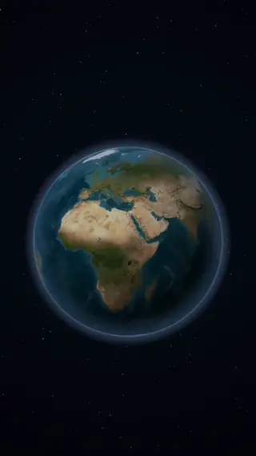
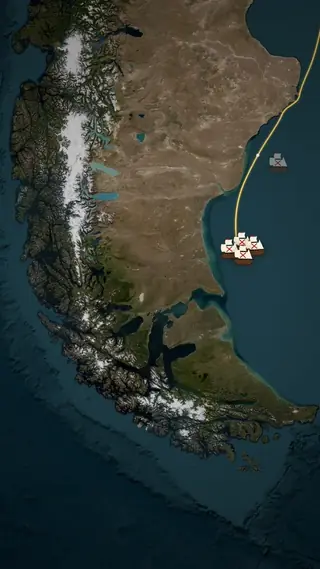
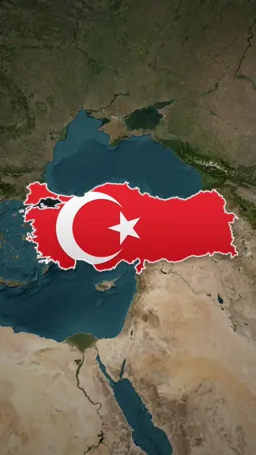
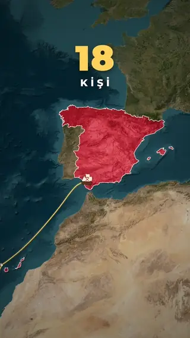
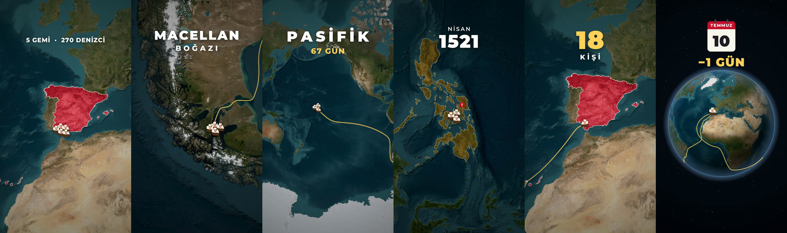
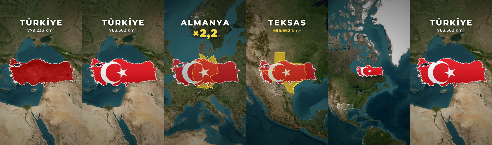

# map-shorts 🗺️🎬

**Seslendirmeden profesyonel harita animasyonlu Shorts üreten yapay zekâ skill'i.**
*An AI-agent skill that turns a narration into a fluid, satellite-map animated vertical video.*

Uydu haritası, sinematik kamera uçuşları, 3D dünya, çizilerek beliren sınırlar, rotalar,
gemiler, bayraklar, sayaçlar, minimal başlıklar ve ses efektleri — hepsi kodla çizilir
ve `ffmpeg` ile 1080×1920 / 60 fps render edilir. Ajan (Claude, Gemini, GPT/Codex, …)
metni okur, sahne sahne görselleri planlar, `scene.py` yazar, kareleri kontrol eder ve
videoyu üretir.

<p align="center">
  
  
  
  
</p>

**Macellan–Elcano seferi** (54 sn, tamamı ajan tarafından kodlandı ve render edildi):

<p align="center"></p>

**Türkiye'nin gerçek boyutu** (29 sn):

<p align="center"></p>

> Önizlemeler sessiz ve küçültülmüştür; gerçek çıktı 1080×1920, 60 fps, seslendirme + efektli MP4'tür.

| Örnek | Konu |
|---|---|
| `examples/macellan` | Macellan–Elcano seferi: dünya → İspanya, filo, Macellan Boğazı, Pasifik, Filipinler, dönüş, dünya turu finali |
| `examples/turkiye_gercek_boyut` | Türkiye'nin gerçek boyutu: Almanya/Teksas karşılaştırması, Mercator bozulması |

## Kurulum / Install

**Linux / macOS**
```bash
git clone https://github.com/ozguryrr-design/map-shorts.git
cd map-shorts
bash scripts/setup.sh          # Python venv, bağımlılıklar, Natural Earth verisi, fontlar
```
Gerekenler: Python 3.10+, ffmpeg, cairo kütüphanesi.

**Windows (PowerShell, WSL gerekmez)**
```powershell
winget install Python.Python.3.12    # yoksa; python.org kurulumunda "Add python.exe to PATH" işaretleyin
git clone https://github.com/ozguryrr-design/map-shorts.git
cd map-shorts
powershell -ExecutionPolicy Bypass -File scripts\setup.ps1 -InstallFfmpeg
```
`-InstallFfmpeg` ffmpeg'i winget ile kurar (zaten kuruluysa atlanır). Cairo ayrıca kurulmaz:
pycairo Windows'ta hazır paket (wheel) olarak gelir. Microsoft Store Python'u yerine python.org /
winget Python'unu kullanın. Git Bash kullanıyorsanız `bash scripts/setup.sh` de çalışır.

### Ajanınıza tanıtın / Register with your agent
Klasörün kendisi bir skill'dir (`SKILL.md`). Bu klasörü ajanınızın skill dizinine koyun / bağlayın:

| Ajan | Konum |
|---|---|
| Claude Code | `~/.claude/skills/map-shorts` (veya proje içinde `.claude/skills/map-shorts`) |
| OpenAI Codex CLI | `~/.codex/skills/map-shorts` — ya da depo içindeki `AGENTS.md` otomatik okunur |
| Google Antigravity | çalışma alanında `.agents/skills/map-shorts` |
| Gemini CLI, Cursor, diğerleri | depoyu açın ve ajana: *"SKILL.md'yi oku ve uygula"* deyin (`AGENTS.md` de yönlendirir) |

```bash
ln -s "$(pwd)" ~/.claude/skills/map-shorts     # örnek (Linux/macOS)
```
```powershell
# Windows (yönetici izni gerektirmeyen dizin bağlantısı)
New-Item -ItemType Directory -Force "$HOME\.claude\skills" | Out-Null
New-Item -ItemType Junction -Path "$HOME\.claude\skills\map-shorts" -Target (Get-Location)
```

## Kullanım / Usage
Ajana sadece şunu söyleyin:

> "Bu seslendirme metni için harita videosu hazırla: *20 Eylül 1519. Beş gemi…*"

Seslendirmeniz varsa `projects/<ad>/vo/voice.mp3` olarak verin; yoksa ajan geçici bir
yapay zekâ sesi ile çalışır, sesinizi sonra eklediğinizde animasyonlar kelimelere göre
otomatik yeniden hizalanır.

Elle kullanım:
```bash
.venv/bin/python make.py new  benim_videom --text-str "Metin..."
.venv/bin/python make.py tts  benim_videom          # ya da: vo/voice.mp3 + make.py align
.venv/bin/python make.py sheet benim_videom         # önizleme kontak sayfası
.venv/bin/python make.py final benim_videom         # -> out/benim_videom.mp4
```
Windows'ta (PowerShell) `.venv/bin/python` yerine `.venv\Scripts\python` yazın:
```powershell
.venv\Scripts\python make.py final benim_videom
```

## Nasıl çalışır / How it works
* `mapengine/` — Python + Cairo çizim motoru (Web Mercator, uydu karoları, van Wijk kamera uçuşları,
  ortografik dünya, deniz rotası A* bulucu, efektler, prosedürel ses, paralel/devam edebilen render).
* Zamanlama kelimelere bağlıdır: `w("Pasifik")` — ses değişse de sahne kaymaz.
* `references/` — ajan için API, stil rehberi ve sahne tarifleri.

## Lisanslar / Credits
* Kod: MIT.
* Sınır verisi: [Natural Earth](https://www.naturalearthdata.com/) (public domain).
* Uydu altlığı: varsayılan **Esri World Imagery** — atıf gerekir, ticari kullanım için Esri şartlarını
  kontrol edin. Alternatif: `TILE_PROVIDER = "s2"` → EOX Sentinel-2 cloudless 2016 (CC BY 4.0,
  "Sentinel-2 cloudless by EOX IT Services GmbH" atfı ile).
* Font: Montserrat (SIL OFL). Bayraklar: flagcdn.com.
* Geçici ses: edge-tts (Microsoft neural voices), hizalama: faster-whisper.
